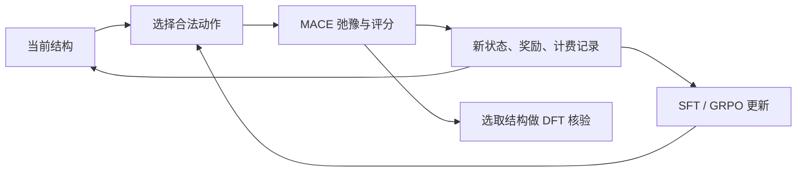

# YSZ RL Lab

**用真实材料计算检验强化学习，也把研究过程变成可追溯的学习过程。**

A research and learning project on physics-verified reinforcement learning for dopant–vacancy configuration search in yttria-stabilized zirconia (YSZ).

这里记录我主导、与 Claude 和 Codex 协作开展的一项材料计算研究：在相同物理计算预算下，让语言模型选择原子排布动作，比较它与随机搜索、模拟退火和局部特征规则的表现。项目同时保留实验设计、失败记录、代码复核和从实验中形成的强化学习理解。

**当前阶段（2026-10-28）：逐步 GRPO 调参与 RSI 工程小试。** 菜单 v4 的回合级 GRPO 已完成，尚未超过同菜单随机或贪心。新的逐步 GRPO 网格在开发菜单上把贪心偏好指标 C 从约 0.022 提高到 0.406，达到预登记的选参门槛；其物理降能效果仍待后续评估。另已启动固定改进器与递归改进器的工程小试，尚无递归收益结论。

## 从哪里开始

| 我想了解…… | 入口 |
|---|---|
| 项目为什么做、怎么走到现在 | [实验时间线](docs/experiments/timeline.md) |
| 最新结果及比较口径 | [结果看板](docs/experiments/results.md) |
| 本轮调参改变了什么 | [开发菜单网格读数](docs/experiments/menu-grid-2026-10-28.md) |
| RSI 实际做到哪一步 | [工程小试状态](docs/experiments/rsi-pilot-status.md) |
| 我的强化学习轨迹 | [从实验出发的学习笔记](docs/learning/README.md) |
| 完整计划、审核、失败与修正 | [历史材料索引](history/README.md) · [项目总记录](PROJECT_RECORD_RSI_YSZ.md) |
| 最近更新 | [每日记录](journal/README.md) |
| 如何在自己的电脑上检查代码和结果 | [复现说明](docs/reproduce.md) |

## 研究问题

YSZ 是掺钇稳定氧化锆。掺入 Y 后，需要氧空位维持电荷平衡；相同数量的 Y 和空位，可以有很多不同排布。本项目研究：**有限次尝试里，怎样更有效地找到低能排布？**

主体系为 **Zr₉₂Y₁₆O₂₀₈**，3×3×3 超胞、316 个真实原子。动作是局部交换 Y／Zr，或把氧空位移到相邻允许位置。每次动作后，MACE 对结构做弛豫并给出能量和力；DFT 用于校准与后续物理验证。



## 已经做了什么

- **物理校准：**比较 MACE 与 DFT 的能量排序、相对能和力，检查截断能、k 点及终态弛豫影响。
- **搜索环境：**统一动作、末态格点映射、结构去重、奖励与物理调用预算，保留失败和回滚记录。
- **SFT 与 GRPO：**用教师示范启动小模型，比较冻结模型、迭代 SFT、回合级／步级 GRPO 和非 LLM 搜索。
- **约束解码：**用合法动作 token 树保证输出可执行；合法率与选择质量分别评估。
- **元流程实验：**记录优化器、更新频率、学习率和输入表示的修改、接受或回退。
- **候选菜单：**每步提供 16 个合法动作及局部特征，同时比较同菜单随机选择与冻结系数的贪心规则。

## 当前结果

指标是：同一个起点产生 4 条轨迹，取其中最大的能量下降，再对 24 个起点求平均。**分数越高越好，单位为 MACE eV／316 原子超胞。** 表中 ± 是起点重采样得到的标准误差，不是最终 DFT 结论，也不是置信区间。

<!-- RESULTS:START -->
| 方法 | 平均降能 ± 标准误差（eV） | 起点数 | 设置 |
|---|---:|---:|---|
| SFT v2 | 1.714 ± 0.174 | 24 | 旧表示 |
| GRPO 元流程第 3 步 | 1.853 ± 0.167 | 24 | 旧表示 |
| 局部特征贪心 | 2.561 ± 0.170 | 24 | 候选菜单，非 LLM |
| 同菜单随机 | 1.835 ± 0.196 | 24 | 候选菜单，主要随机对照 |
| SFT v4 | 1.804 ± 0.194 | 24 | 候选菜单 |
| GRPO v4 | 1.851 ± 0.168 | 24 | 候选菜单 |
<!-- RESULTS:END -->

判读有明确边界：冻结贪心在种子 2/3 的复现中也优于同菜单随机；菜单 v4 的已测 SFT 和回合级 GRPO 尚未显示超越两个对照的优势。旧表示 v2/v3 与菜单随机的比较是事后跨动作接口比较，应与 v4 的同菜单对照区分。对既有判断的更正保留在历史记录里。

菜单 LLM 的探索性接受规则是：相对同菜单随机和贪心两者，配对改善均达到 `max(0.10 eV, 1 × 配对标准误差)`。这用于选择下一步实验；最终结论仍需在没有参与选方案的起点和多个种子上确认。这里尚未宣称实现可持续累积的递归自我改进。

### 逐步 GRPO：开发菜单上的新进展

下表来自一次已完成的读数作业，所有配置评估相同的 208 份开发菜单。C 表示模型捕获了多少冻结贪心分数相对均匀随机的优势；均匀随机为 0，始终选贪心最优项为 1。C 不是动作命中率，也不是物理降能。

<!-- MENU_GRID:START -->
| 配置 | 学习率 | 每轮更新次数 | C |
|---|---:|---:|---:|
| SFT v4 | — | — | 0.0217 |
| 985（原配方） | 2e-5 | 8 | 0.0216 |
| 988（原配方重复） | 2e-5 | 8 | 0.0322 |
| 989 | 2e-5 | 16 | 0.0251 |
| 990 | 5e-5 | 8 | 0.0238 |
| 991 | 5e-5 | 16 | 0.1071 |
| 992 | 1e-4 | 8 | 0.0227 |
| 993 | 1e-4 | 16 | 0.4055 |
| 994 | 3e-4 | 8 | 0.3941 |
| 995 | 3e-4 | 16 | 0.2636 |
<!-- MENU_GRID:END -->

最高配置 993 相对原配方提高约 0.384，达到预登记的 0.05 探索门槛。原配方两次运行的差约 0.0107，仅是一对重复的观察差，不能充当所有配置的标准误差。993 与 994 的差也不足以建立可靠排名。学习率与更新频率的联合设置改变了偏好，尚未确定单一原因。

这份菜单已经参与多次方案决策，作为开发数据使用。延长训练与最后一轮的物理评估已按研究记录安排，尚未有本地完整结果。[定义、原始摘要和判读 →](docs/experiments/menu-grid-2026-10-28.md)

局部配位规则本身已有 YSZ 前作：Dong 等在 2017 年已用第一／第二近邻配位偏好加权搜索 8YSZ 低能构型。本项目的菜单动作、训练配方与受控比较需要另外检验，当前不作“首次 RSI／首次发现配位规则”的主张。[原论文](https://arxiv.org/abs/1701.05089)

## 这也是一条学习轨迹

笔记围绕真实实验中的问题组织：

1. **状态、动作、奖励：**一次原子交换如何变成一条训练经验？
2. **SFT：**模仿教师教会了什么，教师数据又没有提供什么？
3. **GRPO：**如何比较一组轨迹，怎样约束策略更新？
4. **约束解码：**为什么“输出合法”与“动作有效”是两件事？
5. **公平比较：**为什么加入贪心和同菜单随机后，对已有结果的判断发生了变化？
6. **训练配方与证据：**为什么偏好读数上升，还需要物理评估？[本轮学习材料](docs/learning/training-and-diagnostics.md)

这些是根据实际项目整理的解释和待回答问题，不把读过一个概念或运行过代码当成已经掌握它。[阅读学习轨迹 →](docs/learning/README.md)

## 快速检查

需要 Python 3.10+。以下步骤使用已保存的数据和 CPU 几何代码：

```bash
git clone https://github.com/Nathan10969/ysz-rl-lab.git
cd ysz-rl-lab
python3 -m venv .venv
source .venv/bin/activate
python -m pip install -r requirements-cpu.txt
python tools/check_publication.py
python -m unittest discover -s tests -v
python tools/results.py
python tools/results.py --paired meta_s6_greedy meta_s6_menurandom
python examples/inspect_state.py
```

完整训练需要另外准备 Qwen、MACE、训练依赖及合适硬件；DFT 还需要独立的 VASP 使用环境。原始代码、环境记录与公开包能复现的范围见 [复现说明](docs/reproduce.md)。

首版在独立 Python 3.12 环境完成了公开包检查、9 项发布／结果测试、6 项已有晶格／校准测试和 CPU 状态示例。[验证记录](docs/validation.md)

## 我的角色与 AI 协作

项目由 **[Nathan10969](https://github.com/Nathan10969)** 主导：提出研究问题、确定目标和资源边界、提出质疑、选择方向，并学习和解释实验方法。Claude 与 Codex 参与代码、实验执行、技术复核和文档整理。具体分工与修改依据见 [贡献与协作说明](docs/contributions.md)。

## 更新方式

每天 **20:00，America/Los_Angeles**，由本机接续读取已有研究记录，整理有证据的新进展，通过检查后同步 GitHub。有变化才提交；日期使用真实同步日期。历史材料首次导入时不伪造过去的 Git 提交。

公开文件通过白名单导出，并记录原文件与公开副本的哈希。发布过程只整理已有材料；研究计算沿原项目流程运行。[更新约定](docs/updating.md) · [来源清单](provenance/manifest.json)

## 代码与参考

核心实现位于 [`research/formal12/scripts/`](research/formal12/scripts/)。历史实现和测试位于 [`research/scripts/`](research/scripts/) 与 [`research/tests/`](research/tests/)。

本仓库自有代码和文档采用 [MIT License](LICENSE)。外部模型、软件和论文保留各自许可与署名；仓库提供引用与获取入口，详见 [第三方说明](THIRD_PARTY.md)。
